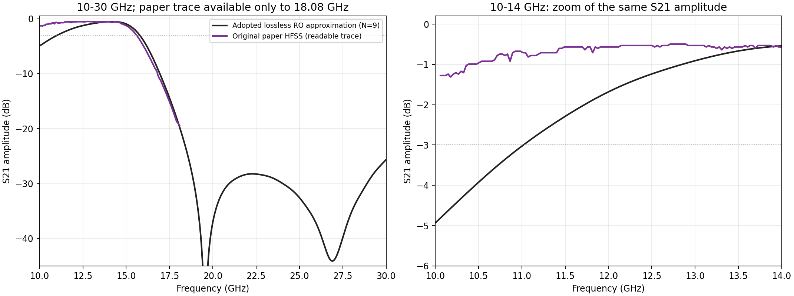
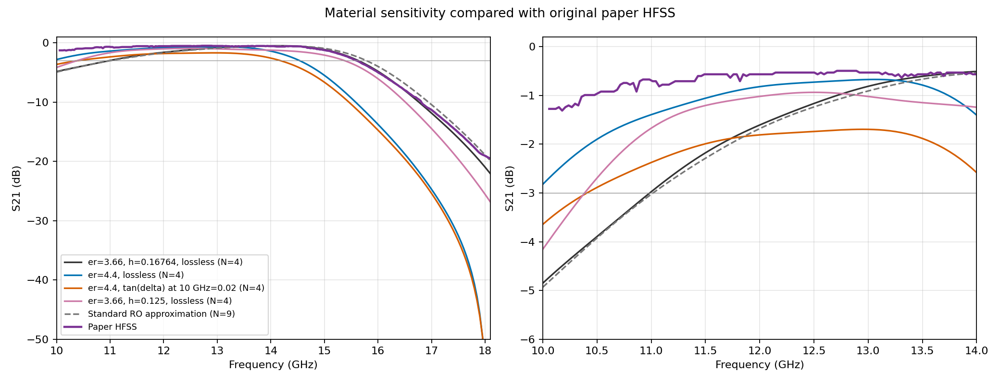

# Dall-EM図3(a)のマスク回路シミュレータ：目的・検証結果・未解決事項

2026年10月1日。対象はGuoらの原論文 *Dall-EM*（IMS 2025）の図3(a)。

## 1. 背景とモチベーション

### 1.1 マスクから周波数応答を計算する目的

原論文は、目標とする周波数応答から金属配置を生成する逆設計を扱う。構造を18×18の画素表現で学習し、10–30 GHzを1 GHz間隔で表した21点のS21振幅を拡散モデルの条件入力とする。学習用の構造と応答の組は電磁界解析で作成している。[原論文・II-B、III](https://doi.org/10.1109/IMS40360.2025.11103838)

本プロジェクトの目的は、二値マスクを一定の材料・給電・計測条件で解析するPythonライブラリを用意し、公開回路の応答を独立したソルバで検証することである。回路の見た目が同じでも、基板、給電線、短絡、ポートの条件が違えば応答は変わる。形状の整合、S行列の抽出、数値設定への依存、原論文との一致をそれぞれ確認する。

比較対象には、給電寸法とHFSSの応答曲線が公開された図3(a)を選んだ。主な比較対象は原論文の数値解析結果である。図4の試作測定と先行COMSOLの画像は、異なる構造・解析条件を含むため図3(a)の一致判定には用いない。

### 1.2 ターゲットと再現性の参照値

原論文の設計ターゲットには、理想フィルタの仕様を用いた例がある。図3(a)の要求は10–15 GHzの通過域と16–30 GHzの阻止域である。既存のマスク回路の応答だけをターゲットとしているわけではなく、この仕様を満たす配置の探索自体が逆設計の課題になる。[原論文・III-A、III-B](https://doi.org/10.1109/IMS40360.2025.11103838)

本プロジェクトでは、ターゲットへの近さと原論文の再現性を別に評価する。[ターゲット例](../examples/data/lowpass-target.csv)は、上記の帯域に線形振幅1・0を指定した理想ローパスの21点である。これは利用例として定めた配列で、著者の数値ターゲットを取得したものではない。再現性の参照値には、図3(a)の紫色のHFSS曲線を画像から読み取った振幅を使う。

### 1.3 実装する範囲と対象外

実装範囲は、内側16×16のマスク入力、3次元モデルの生成、openEMSによる両側励振、全複素Sの抽出・保存、Python APIとCLI、利用側のRMSE採点スクリプトである。基板・給電・短絡は設定から付加し、マスクと実効設定、終了判定、波形、応答を再確認できる形で保存する。

今回の範囲から外すものは次のとおりである。

- 拡散モデルやCNNの学習、マスク生成、最適化アルゴリズム。
- 基板製造と実測、実材料・製造品の性能保証。
- 18×18の端子込み表現の自動変換と、入力マスクの接続・隙間の自動修正。
- Web UIとHTTPサーバーの追加。
- 厳密な受動性について、数値的な電力超過をゼロまで追求する作業。残差は記載し、S行列を受動性へ強制補正しない。

未知の材料値や寸法を曲線へ合わせた条件は、原論文の条件として確定しない。感度試験の仮定値と、出典から確認できた条件を区別する。

## 2. 結果とできていないことのまとめ

### 2.1 採用する標準モデル

**標準モデルには無損失RO4350B相当と画素9分割格子を採用する。** 原論文の既知の基板条件を保ち、材料試験の4分割格子で比較した4条件のうちHFSSの読取範囲全体に対する誤差が最小だった条件である。採用は基準モデルの選択であり、原論文の定量再現を達成したという判定ではない。

| 項目 | 採用値 | 根拠・仮定 |
|---|---|---|
| 中央マスク | 内側16×16、2 mm角、ピッチ0.125 mm、金属132セル | 原論文の図から抽出。本文の18×18と内側16×16の対応は図からの解釈 |
| 基板 | εr=3.66、厚さ0.16764 mm（6.6 mil） | 原論文図2のRO4350B注記に対応 |
| 誘電体の損失・分散 | 導電率0、一定εr | 無損失近似。原論文の詳細設定は不明 |
| 上面金属 | PEC、厚さ0.035 mm | 厚さは原論文。銅の導電率・粗さは扱わない |
| 裏面GND | z=0の底面全体をPEC | 原論文のGND範囲を確認できていないための仮定 |
| 給電 | 幅0.35 mm、左右各12 mm | 幅と右側の長さは原論文。左側の長さは同長と仮定 |
| 給電中心 | 左y=−0.5625 mm、右y=−0.6875 mm | 図から推定 |
| 短絡 | 幅0.125 mmのPEC角柱2本。中心(−0.9375, +0.9375)、(−0.3125, −0.9375) mm | 位置は図から推定。実際の径・ランド・めっきは不明 |
| ポート・基準面 | MSLポート、実数50 Ω。計測面x=±10 mm | マスク端から左右各9 mmの給電線を含む。原論文のポート詳細・デエンベディングは不明 |
| 領域・境界 | x=±13 mm、y=±3 mm、上面z=3 mm。x面PML8、y面・上面MUR、底面PEC | 採用する計算条件 |
| 格子 | 画素9分割、基板16分割、最大間隔0.075 mm、給電端局所間隔約0.004167 mm | 完成格子の給電端配置を検査。電流計測点は計測面から前後±0.025 mm |
| 周波数・時間条件 | 10–30 GHzの401点、終了エネルギー比10⁻⁷、最大400,000ステップ | 2励振を独立に解析。各励振のタイムアウト7,200秒、標準4スレッド |

設定は[同梱YAML](../src/maskrf/configs/paper_corrected.yaml)と[編集用設定例](../examples/configs/paper_corrected.yaml)で管理する。無損失という語は材料の吸収損失をゼロとする意味であり、反射・放射による透過低下は生じる。

ターゲット採点の標準指標は、線形振幅 `|S21|` のRMSEとする。原論文の平均L1による評価とは指標を区別し、大きな局所誤差を相対的に強く反映する候補比較に用いる。

### 2.2 実装・数値検証・原論文比較の到達点

ライブラリは、16×16の二値配列・CSV・JSON・白黒PNGを受け取り、全複素S11・S12・S21・S22、振幅・位相、指標と実効設定を返す。新規解析の成功には両励振の正常終了と減衰を要求する。保存済み応答は `load_response()` で読み込む。ライブラリと保守対象のテストは過去の `tmp/` に依存しない。[利用方法](usage.md)

図3(a)の採用モデルでは、画素8→9分割の最大複素S差0.011985、10–14 GHzのS21最大差0.02584 dB、下降側−3 dB交差の変化0.1012%を確認した。いずれもプロジェクトの格子差基準を満たす。この確認は当該マスク・当該条件についてのもので、連続体の真値に対する誤差上限ではない。

原論文HFSSとの比較結果は次のとおりである。差は「本実装−原論文」で、原論文の値は画像読取値である。

| 指標 | 採用モデル・9分割 | 原論文HFSS | 差 |
|---|---:|---:|---:|
| S21・10.5 GHz | −3.924 dB | −0.965 dB | −2.959 dB |
| S21・12 GHz | −1.681 dB | −0.567 dB | −1.114 dB |
| S21・14 GHz | −0.541 dB | −0.567 dB | +0.027 dB |
| S21・16 GHz | −3.984 dB | −4.982 dB | +0.998 dB |
| 下降側−3 dB交差 | 15.782 GHz | 15.600 GHz | +0.182 GHz（約1.17%） |
| S21のdB RMSE・10.5–18 GHz | 1.20 dB | 比較の参照曲線 | 0.5 GHz間隔の16点 |

下降側−3 dB交差は、S21が−3 dBを上から下へ横切る位置を直線補間した値である。低域から上昇する側の交差とは区別する。dB RMSEは振幅のdB差から計算しており、ターゲット採点の線形振幅RMSEとは異なる。

図1：黒線が採用モデル、紫線が原論文HFSS。左は10–30 GHz、右は同じS21振幅の10–14 GHz拡大図。参照曲線の読取範囲は約10.06–18.08 GHzで、−20 dB以下が原図で見切れるため、参照値を全帯域へ延長していない。[SVG](figures/adopted-ro-paper.svg)

**原論文の定量再現は未達である。** 10.5 GHzの約2.96 dBの透過不足は、画像読取誤差の目安±0.15 dBと最後の格子差を上回る。遮断周波数付近の一致だけでは、通過域と阻止域を含む一致の根拠にならない。

### 2.3 分かったことと未解決事項

材料・厚さの変更は通過域と下降域の両方を変える。誘電率を4.4へ上げると低域の透過は改善したが、遮断周波数と下降域の原論文との差が増えた。試験した材料損失の追加では低域の不足は解消しなかった。採用モデルの低域の電力収支では、透過不足の主な成分は反射である。これらの結果から、材料損失の省略だけを不一致の原因とする根拠は得られていない。

| 未解決事項 | 現在確認できている範囲 |
|---|---|
| 低域応答の不一致の原因 | 給電、短絡、角接触、ポート場の仮定を特定する証拠は不足 |
| 厳密な受動性 | 最大σmax(S)²=1.00454。約0.454%の電力超過が残り、数値許容1.02以内でも厳密条件1以下は未達。超過ゼロの追求は今回の作業対象外 |
| 境界への依存 | 採用する最細格子での境界距離3→6 mm、MURとPMLの比較は未実施 |
| 原論文の完全な解析条件 | 元CAD・数値マスク、ビア寸法、左給電長、GND範囲、基準面、損失・分散設定が不足 |
| 外部ソルバとの全S照合 | 原論文と先行COMSOLから、同一条件の反射・位相を含む全複素Sを確保できていない |
| 実材料・製造の再現 | 銅損失・粗さ・分散、有限幅接続、微小隙間は未評価。画像上の角接触を理想形状のまま保持 |
| 任意マスクへの一般化 | APIは完了・減衰・有限値を検査するが、個別の格子収束や受動性による自動選別は実装していない |
| ターゲットの実現可能性・帯域合否 | 理想ローパス例の達成可能性と、各帯域の合否基準は未検証・未実装 |

現時点の用途は、条件を明示したマスク評価と感度調査である。原論文の絶対挿入損失の再現や、未検証マスクを高精度な教師ラベルとして採用する判断には追加検証が必要になる。採用runは約549万の幾何セル、4スレッド、2励振で記録上約58分を要しており、大量評価の費用も未評価である。

## 3. 実験計画とその結果

### 3.1 入力形状と先行実装の照合

形状の照合では、原論文の分割線・端子枠から内側16×16を読み、公開COMSOL形状画像の各セル中心と比較する。2 mm角を16分割したピッチは0.125 mmになる。Obsidian-Journalsの中央マスクは金属132セルで、本実装との差は0/256セルだった。中央の二値配置の整合を支持するが、基板・給電・短絡を含む3次元モデルの一致は未確認である。[分割の根拠](data/grid-measurements.json)、[照合数値](data/prior-art-verification.json)

先行資料のうち、Obsidian-JournalsとPlayGroundは形状とCOMSOL振幅の参照に使う。gerber-gen-testはopenEMSの形状生成例として参照するが、片側励振時の出射波／入射波をS22としており、全S行列の正解データには使わない。HFSS自動化やアンテナ設計の他の実装は、図3(a)と条件が違うため数値比較の対象外とする。[先行実装の調査記録](#42-先行実装と再現記録)

### 3.2 全S行列の抽出と実装の検査

抽出式は、2回の独立励振で得た両ポートの入射波を列に並べた行列Aと、出射波を列に並べた行列Bから、S=BA⁻¹として全成分を求める。非励振側の残留入射波もAへ含める。ポートは共通の実数50 Ωで定義し、給電端は導体内側1/3・外側2/3の格子配置を検査する。電流は対称な2点で計測し、導体厚を含む計測範囲を確保する。

既知S行列と相互入射を含む模擬波形を本番の後処理に与えた最大復元誤差は1.11×10⁻¹⁶だった。採用runの入射行列の最大条件数は1.0236である。材料試験10ケースでは、保存波形からの再抽出と保存Sの最大複素差は全ケースで0だった。これらは抽出と保存の一貫性を確かめる検査であり、ポート場の物理的な正確さを別ソルバで確認した結果ではない。[抽出式の検査](data/prior-art-verification.json)、[再抽出](data/material-extraction-verification.json)

ライブラリの検査は、入力拒否、Sの成分順序、新規解析時の入出力、保存済み応答の読み込み、採点式、CLIの出力を対象とする。保守する[抽出の回帰テスト](../tests/test_postprocess.py)は、周波数ごとに各成分が異なる既知の全Sと相互入射を本番後処理へ与え、抽出結果とCSV・Touchstoneの成分順序を検査する。[実行・比較の回帰テスト](../tests/test_execution.py)は、未完了・未減衰の解析を正常結果や格子差の合格として扱わないことを確認する。

wheelの独立環境への導入とソースディレクトリ外での利用も確認している。採用runの保存ソースと現在の `model.py`・`geometry.py`・`postprocess.py` はバイト単位で一致する。[コア実装の照合](data/report-metrics.json)

### 3.3 格子差・時間終了・電力の検査

数値検証では物理条件を固定し、格子細分化による全複素S、10–14 GHzのS21、下降側−3 dB交差の変化を調べる。判定基準はプロジェクトで定めた数値差の目安であり、原論文から引用した再現性の合格条件ではない。

| 検査 | 判定基準 | 採用モデルの結果 |
|---|---|---|
| 解析の完了 | 両励振の正常終了と設定した減衰条件の達成 | 両励振で10⁻⁷を達成 |
| 全Sの格子差 | 10–30 GHzの401点・全4成分で最大複素絶対差≤0.02 | 8→9分割で0.011985 |
| 帯域振幅の格子差 | 10–14 GHzのS21最大差≤0.2 dB | 0.02584 dB |
| 特徴周波数の格子差 | 細分後の−3 dB交差を分母として変化≤1% | 0.1012% |
| 電力の数値許容 | 最大σmax(S)²≤1.02 | 1.00454。厳密な受動性は未達 |

複素絶対差0.02は0.02 dBや相対誤差2%ではない。実数50 Ωの波で定義した最大特異値σmax(S)の二乗は、任意の入射波の組合せに対する最大電力比を表す。厳密な受動性には1以下を要求する。

| 図3(a)の格子比較 | 最大複素S差 | 10–14 GHzのS21最大差 | −3 dB交差の変化 |
|---|---:|---:|---:|
| 画素4→6分割 | 0.077155 | 0.06031 dB | 0.6346% |
| 画素6→8分割 | 0.025706 | 0.02207 dB | 0.1997% |
| 画素8→9分割 | 0.011985 | 0.02584 dB | 0.1012% |

画素とともに基板・最大間隔・給電端近傍も細分化しており、格子はすべて入れ子ではない。最後の比較で基準を満たす9分割を採用する。直線線路の基準モデルでは最後の最大複素S差0.004473を確認した。図3(a)の最大相反性誤差|S12−S21|は0.0007445である。格子差・終了判定・相反性の確認だけでは、境界独立性や厳密な受動性の検証は完了しない。[格子比較](data/mesh-comparison.json)、[監査](data/convergence-audit.json)

### 3.4 原論文と先行COMSOLの応答比較

原論文比較では、図3(a)のHFSS曲線をPDFの埋め込み画像から読み取る。読取範囲は約10.06–18.08 GHzで、座標に由来する誤差の目安は±0.15 dB・±0.06 GHzである。これはソルバ誤差の推定ではない。10.5–18 GHzの0.5 GHz間隔16点でdB RMSEを計算すると、採用モデルは全体1.20 dB、10.5–14 GHzの8点では1.54 dB、14.5–18 GHzの8点では0.70 dBになる。[HFSS読取CSV](data/paper-hfss.csv)、[抽出条件](data/paper-extraction.json)

先行COMSOLは別の条件付き比較とする。Obsidian-Journalsの画像にはS11・S21の振幅があり、10–30 GHzの0.5 GHz間隔41点を読み取れる。位相・S12・S22を含む全複素Sは確保できていない。読取誤差の目安は±0.2 dB・±0.07 GHzである。

| 指標 | 原論文HFSS | 先行COMSOL | 本実装・採用モデル |
|---|---:|---:|---:|
| S21・10.5 GHz | 約−0.97 dB | 約−1.29 dB | −3.92 dB |
| 下降側−3 dB交差 | 約15.60 GHz | 約13.96 GHz | 15.78 GHz |
| S21・30 GHz | 読取範囲外 | 約−3.12 dB | −25.65 dB |

先行COMSOLと本実装は低域・下降域・高域の応答が異なる。再現記録記事にはFR4を仮定したとの説明があるが、COMSOLの実際の誘電率・厚さ・損失・ポート条件は未確認である。同じ中央マスクを使うことだけから、ソルバの精度差としては説明できない。記事とObsidianの画像は同じ作業者の結果なので、独立した検証として二重には数えない。[COMSOLの読取・比較記録](data/comsol-metrics.json)

### 3.5 材料・厚さ・損失の感度試験

感度試験では、マスク、給電寸法、短絡、PEC厚、50 Ω参照、計測面、境界を固定し、下表の6条件を比較する。粗格子2分割で6条件、4分割で基準を含む4条件を解析した。合計10ケース・20励振は正常終了し、減衰条件10⁻⁶を満たす。[設定と計画](data/material-experiment.json)、[材料・格子の監査](data/material-audit.json)

| 条件 | εr | 厚さ mm | 10 GHzのtanδ | 確認した画素分割 |
|---|---:|---:|---:|---|
| 無損失RO相当・基準 | 3.66 | 0.16764 | 0 | 2・4 |
| 誘電率だけ変更 | 4.4 | 0.16764 | 0 | 2・4 |
| RO相当の誘電損失を追加 | 3.66 | 0.16764 | 0.0037 | 2 |
| εr=4.4とFR4相当の損失 | 4.4 | 0.16764 | 0.02 | 2・4 |
| 薄い基板 | 3.66 | 0.125 | 0 | 2・4 |
| 厚い基板 | 3.66 | 0.4 | 0 | 2 |

εr=4.4、tanδ=0.02、厚さ0.125/0.4 mmは感度試験の仮定値で、先行COMSOLの確認済み設定ではない。RO4350Bのtanδ=0.0037はRogers公式データシートの10 GHz値を参照する。試験ではκ=2πf₀ε₀εr tanδ(f₀)、f₀=10 GHzの一定導電率に換算するため、tanδ(f)=tanδ(10 GHz)×10 GHz/fとなる。10–30 GHzで一定tanδや実材料の分散を与えた試験ではない。

材料変更時に給電幅を50 Ωへ再設計していないため、線路インピーダンスと接続条件の変化も結果に含む。計測面間に含む左右各9 mmの給電線にも損失が加わる。厚さ変更では上側境界z=3 mmを固定するので、空気層の厚さも変わる。

同じ細分化方針の4分割で比較した4条件の原論文に対する誤差は次のとおりである。通過域は10.5–14 GHz、下降域は14.5–18 GHzの各8点で、全体は16点を等重みで評価する。厚さ変更ではz格子が異なる。

| 条件・4分割 | 通過域dB RMSE | 下降域dB RMSE | 全体dB RMSE | −3 dB交差の絶対誤差 GHz |
|---|---:|---:|---:|---:|
| 無損失RO相当 | 1.50 | 0.78 | 1.20 | 0.032 |
| 誘電率だけ4.4 | 0.56 | 15.90 | 11.25 | 1.065 |
| εr=4.4＋FR4相当損失 | 1.53 | 16.01 | 11.37 | 1.424 |
| 厚さ0.125 mm | 0.85 | 3.15 | 2.31 | 0.227 |

図2：紫がHFSS、黒・青・橙・桃が4分割の各条件、灰色破線が採用する9分割。左は下降域を含むS21、右は同じS21の10–14 GHz拡大図である。[SVG](figures/material-paper-comparison.svg)

誘電率を4.4へ上げたとき、基準に対する−3 dB交差の変化は2分割で−1.103 GHz、4分割で−1.097 GHz、10.5 GHzのS21改善はそれぞれ+2.038 dB、+1.995 dBだった。通過域だけの誤差は減るが、下降域と遮断周波数の誤差は増える。原論文の既知条件を守り、読取範囲全体を評価する目的では、比較した4条件のうち無損失RO相当を選ぶ。

損失の追加では、RO相当の2分割で10.5 GHzのS21が約0.141 dB低下し、εr=4.4の4分割で約0.987 dB低下した。厚さ0.125 mmの4分割では低域を約1.200 dB改善したが、原論文の基板厚とは異なり下降域の誤差も増えた。厚さ0.4 mmの粗格子では全体dB RMSEが2.55、基準が2.60だったが、4分割以上では未検証である。したがって全6条件や任意の材料値について大域的な最良条件を求めた結果ではない。[採点数値](data/material-paper-selection.json)

材料試験の2→4分割の最大複素S差は約0.199–0.243で、精度基準0.02を満たさない。基準4分割と採用9分割の差も最大複素S差0.113、−3 dB交差0.150 GHzである。4分割の交差が原論文へ近いことだけを、9分割より正確という根拠にはしない。材料差の傾向と、各条件の絶対値の収束は区別する。[細分化比較](data/material-refinement.json)

### 3.6 低域の電力収支と給電・短絡の仮説

低域の不足を調べるため、採用モデルのポート1励振について、反射を|S11|²、透過を|S21|²、両ポートで回収しない成分を1−|S11|²−|S21|²として計算する。

| 周波数 | 反射電力 | 透過電力 | 両ポートで回収しない電力 |
|---|---:|---:|---:|
| 10.5 GHz | 59.01% | 40.51% | 0.48% |
| 12 GHz | 31.29% | 67.90% | 0.80% |

透過不足の主な成分は反射である。回収しない成分には放射・境界への流出・数値誤差が含まれるため、材料の吸収損失とは同一視しない。この結果と材料試験から、給電・短絡・ポートの整合条件を個別に検証する必要がある。[電力値](data/report-metrics.json)

給電接続の一つの仮説として、マスク直前の長さ0.125 mmだけを幅0.35→0.125 mmへ狭める試験を行った。外端・計測面・材料・短絡と粗格子を固定した比較では、10.5 GHzのS21が−0.152 dB変化し、−3 dB交差は+0.058 GHz変化した。低域を大きく改善する兆候はなく、この接続形状は採用しない。格子差が残る試験なので、全給電形状の影響が小さいとは一般化しない。

2本の短絡を除去したケースでは、最初の励振が減衰条件を満たさず、有効な全Sを得ていない。短絡が低域差の原因かどうかは判定できない。先行COMSOLに短絡がないと確認した試験でもない。[給電・短絡の試験記録](data/README.md#給電短絡)

### 3.7 ターゲット採点の確認

採点スクリプトは公開APIで応答を取得し、ターゲット周波数に補間した線形振幅差のRMSEを計算する。各点は等重みで、位相は含めない。[利用仕様](usage.md)

採用モデルを理想ローパスの21点へ採点すると、RMSEは **0.20037665494010062** になる。このターゲットは通過域6点、阻止域15点なので、点数の多い帯域の寄与が大きい。単一値が小さくても帯域の各仕様を満たすとは限らない。ターゲット入力の拒否条件、補間、採点式、標準指標、CLIがfloatを1行で返すことを検査している。[採点の確認結果](data/target-score-verification.json)

### 3.8 未実施の検証計画

以下は未解決事項を確認するための計画で、実施済み結果には含めない。

| 検証 | 固定条件と比較方法 | 確認すること |
|---|---|---|
| 最細格子での境界距離 | 材料・形状・計測面・内部格子を固定し、y方向と上側の境界を個別に3→6 mmへ拡大 | 格子比較に共通して残る境界誤差 |
| 境界種類 | 距離を固定してMURとPMLを比較 | 距離と吸収条件の影響の区別 |
| 給電・短絡・角接触 | 原形状を基準に、接続幅、微小隙間、ビア寸法、給電接続を個別に変更 | 低域の反射差の原因。短絡除去は減衰問題の確認が先に必要 |
| 別ソルバでの同一モデル | 3次元形状、材料、ポート、基準面をそろえて全複素Sを比較 | 電磁界・ポートモデルの外部照合 |
| 代表マスク群 | 空、全面金属、直線接続、非対称、孤立島、角接触を含む例で格子差と受動性を検査 | 任意マスク評価と教師データ選別の基準 |

原論文のCAD・数値応答・解析設定を入手できれば、仮定と著者の条件の差を直接検査できる。取得できない場合は、上記の感度試験を仮定付きの検証として扱う。

## 4. 参考資料

### 4.1 一次資料

1. Yingqing Guo et al., *Dall-EM: Generative AI with Diffusion Models for New Design Space Discovery and Target-to-Electromagnetic Structure Synthesis*, IMS 2025. [DOI](https://doi.org/10.1109/IMS40360.2025.11103838)。図2の構造条件、図3(a)のマスク・HFSS振幅、II-B・IIIの学習入力と設計ターゲットを参照。
2. [openEMS公式メッシュ指針](https://wiki.openems.de/index.php/FDTD_Mesh.html)、[固定版MSL Notch Filter例](https://github.com/thliebig/openEMS/blob/5f36e7f3a2367123f00999491a069aed50c6f244/python/Tutorials/MSL_NotchFilter.py)。給電端の格子とポート計測の根拠。
3. [Rogers RO4000公式データシート](https://rogerscorp.com/-/media/project/rogerscorp/documents/advanced-electronics-solutions/english/data-sheets/ro4000-laminates-ro4003c-and-ro4350b---data-sheet.pdf)。設計用εr=3.66と10 GHzのtanδ=0.0037を参照。
4. Chai & Draxler (2014), [RMSE or MAE?](https://gmd.copernicus.org/articles/7/1247/2014/)。評価量の定義と大きな誤差の寄与に関する資料。

### 4.2 先行実装と再現記録

1. [PlayGroundの形状生成コード](https://github.com/jwt625/PlayGround/blob/4e2c82c32cdd28d50bf28b2da663e0c1af45650e/20250624_inv_design_filter/main.py)。固定コミットの16×16形状生成を参照。
2. [Obsidian-JournalsのCOMSOL作業記録](https://github.com/jwt625/Obsidian-Journals/blob/67227f7579e27259e75e9fadcefe345f856e5137/Playground/20250624%20inverse%20designed%20microwave%20filters.md)、[S11・S21の10–30 GHz画像](https://github.com/jwt625/Obsidian-Journals/blob/67227f7579e27259e75e9fadcefe345f856e5137/10-30GHz.png)。固定コミットのマスク・振幅画像を照合。
3. [gerber-gen-testの解析コード](https://github.com/VatsalKhanna5/gerber-gen-test/blob/4a722231e15d9d6c0c55b29070a42d61186db99b/rfgerber/em_simulation.py)。形状生成とS22抽出方法を確認。
4. [Vik's Newsletterの再現記録記事](https://www.viksnewsletter.com/p/dallem-in-30-hours)。FR4の仮定に関する二次資料。記事中の別のMegtron 6試作測定は今回の比較対象に含めない。

### 4.3 設定・結果・検証証拠

| 内容 | 保存先 |
|---|---|
| 現在の実装と利用仕様 | [src/maskrf](../src/maskrf/)、[利用方法](usage.md)、[tests](../tests/) |
| 条件の出典・仮定 | [conditions.md](data/conditions.md)、[抽出条件](data/paper-extraction.json) |
| 採用モデルの全S・実効設定・終了判定 | [CSV](../tests/fixtures/completed-run/sparameters.csv)、[Touchstone](data/adopted-network.s2p)、[実効設定](../tests/fixtures/completed-run/effective.json)、[終了判定](../tests/fixtures/completed-run/status.json) |
| 定量比較と掲載図の入力 | [指標JSON](data/report-metrics.json)、[図生成](../examples/plot_report.py) |
| 材料試験の条件と結果 | [全ケース一覧](data/material-summary.csv)、[原論文に対する採点](data/material-paper-selection.json) |
| 掲載結果の保存データ | [データの説明と出典](data/README.md) |

本レポートは保存済みの完了解析と検証記録に基づく。本文・図・掲載結果を確認する数値データは `docs/`、完了済み応答のfixtureは `tests/fixtures/` に保存する。新しい実行結果と作業記録はGit管理外の `tmp/` に置く。
