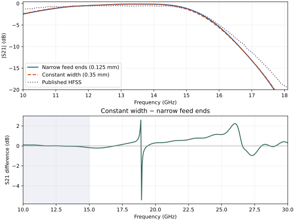
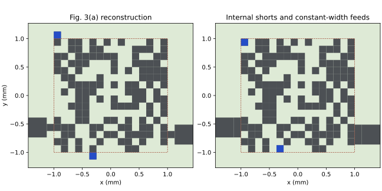

# Reproducing the circuit and response of Dall-EM Fig. 3(a)

[日本語](reproduction-report.ja.md)

We built the low-pass circuit in Fig. 3(a) from the central 16×16 mask, two peripheral shorts, and two feed lines that narrow just before the mask, and simulated it with openEMS. At 4 subdivisions per pixel, the S21 RMSE against the paper's HFSS curve was **0.58 dB** over 10.5–18 GHz. At 10.5 GHz, S21 was **−1.85 dB**, **0.88 dB below** the digitized HFSS value. Among the geometry changes tested, short placement had the larger effect on low-frequency reflection. [Source paper](https://doi.org/10.1109/IMS40360.2025.11103838) · [Comparison data](data/terminal-study-summary.csv)

## 1. Background and motivation

### 1.1 Why calculate the frequency response from a mask?

The paper studies inverse design, generating a metal pattern from a target frequency response. It represents structures as 18×18 pixels and conditions a diffusion model on 21 S21 magnitude samples spaced 1 GHz apart from 10–30 GHz. Electromagnetic simulations provide the structure–response pairs for training. [Source paper, II-B and III](https://doi.org/10.1109/IMS40360.2025.11103838)

The goals of this project are to provide a Python library that evaluates binary masks under specified material, feed, and measurement conditions and to check a published response with an independent solver. Circuits with the same apparent shape can have different responses if the substrates, feeds, shorts, or port settings differ. We check the geometry, S-matrix extraction, sensitivity to numerical settings, and agreement with the paper.

We selected Fig. 3(a) because the paper publishes both feed dimensions and an HFSS response curve. The published simulation is the reference for this comparison. The prototype measurements in Fig. 4 and the earlier COMSOL plots involve differences in geometry and simulation conditions and serve as separate references.

### 1.2 Design targets and reproduction reference

The paper uses ideal filter specifications as design targets in some examples. Fig. 3(a) calls for a 10–15 GHz passband and a 16–30 GHz stopband. The inverse design problem is to find a metal pattern that meets those specifications, which can be chosen independently of the response of an existing mask. [Source paper, III-A and III-B](https://doi.org/10.1109/IMS40360.2025.11103838)

This project evaluates target matching and paper reproduction separately. The [example target](../examples/data/lowpass-target.csv) is an ideal low-pass array of 21 points with linear magnitudes of 1 in the passband and 0 in the stopband. We defined the array to illustrate scoring. For the reproduction reference, we use magnitudes digitized from the purple HFSS curve in Fig. 3(a).

### 1.3 Scope

The library accepts the inner 16×16 mask, generates a 3D model, excites both ports independently in openEMS, and extracts and saves the full complex S-matrix. It provides a Python API and CLI and an example client script for RMSE scoring. The configuration adds the substrate, feeds, and shorts. The library saves the mask, effective settings, completion status, waveforms, and response for review.

The study excludes the following work.

- Training diffusion models or CNNs, generating masks, and developing optimization algorithms.
- Fabricating and measuring boards or guaranteeing the performance of real materials or fabricated circuits.
- Automatically converting 18×18 masks that include terminals or automatically repairing connections and gaps in input masks.
- Adding a web UI or HTTP server.
- Reducing numerical power excess to zero for strict passivity. We report the residuals and preserve the extracted S-matrix.

Values inferred by fitting the curve remain assumptions for sensitivity tests. Conditions attributed to the paper require confirmation from a source.

## 2. Model for Fig. 3(a)

The reproduction uses a CSV containing the central metal pattern and a YAML file specifying the peripheral shorts, feed lines, and simulation conditions. [Mask CSV](../examples/data/fig3a-mask.csv) · [Reproduction YAML](../examples/configs/paper_outer_terminals.yaml)

Fig. 3(a) shows a circuit with a 10–15 GHz passband and a 16–30 GHz stopband. The central metal pattern is a 2 mm square of 16×16 cells. We identified 132 metal cells in the figure. Comparing the terminal frame in Fig. 2 shows that the paper's 18×18 training representation covers the central 16×16 pattern and terminal information along its perimeter. The public geometry image from the earlier COMSOL work also agreed with the central mask, with 0/256 differing cells. [Extraction settings](data/paper-extraction.json) · [Grid and terminal frame check](data/grid-measurements.json) · [Check against prior work](data/prior-art-verification.json)

| Feature | Model settings | Basis in the paper |
|---|---|---|
| Central mask | 16×16, 0.125 mm pitch | Extracted from Fig. 3(a) |
| Left and right feed lines | 12 mm each. Width is 0.35 mm, narrowing to 0.125 mm over the last 0.125 mm before the mask | The figure labels the right feed length and the width of the wide section. We assumed the same length on the left and modeled the neck as roughly one square cell |
| Feed centers | Left y = −0.5625 mm and right y = −0.6875 mm | Estimated from the figure |
| Peripheral shorts | 0.125 mm wide square PEC posts at two outer top-metal cells, connected to the ground plane on the underside | Positions read from the figure. Post dimensions and shape are modeling assumptions |
| Substrate and conductor | RO4350B equivalent with constant relative permittivity of 3.66, 0.16764 mm (6.6 mil) thickness, and zero substrate conductivity. The top PEC is 0.035 mm thick | Substrate and conductor thickness follow Fig. 2. The model uses lossless, dispersion-free materials and ideal smooth conductors |
| Ports | Independently excited MSL ports on the left and right. Real 50 Ω normalization, measurement planes at x = ±10 mm, and excitation planes at x = ±11 mm. There are 9 mm of feed line on each side between the measurement planes | HFSS port type, normalization, reference planes, and de-embedding are unspecified in the paper |
| Boundaries | PML8 at x = ±13 mm, MUR at y = ±3 mm and z = 3 mm, and PEC across the entire bottom face z = 0 to represent the ground plane | The extent of the ground plane in the paper is unknown |

With zero-based rows counted top to bottom and columns left to right, the shorts are at (row, column) = (−1, 0) and (16, 5). Each position adds one top-metal cell connected to adjacent metal in the central mask.

The feed lines in the figure are about one cell wide immediately before the mask and about 2.7–2.8 cells wide outside that section. Corner contacts within the mask follow the image. The figure gives no dimensions or details for short diameter, lands, or plating.

The plan view shows the central region from the geometry XML used for simulation. The dashed outline marks the central 2 mm square. Blue marks the projected area of each short to the ground plane.

## 3. Reproduction results against the HFSS curve

For the main result with peripheral shorts and narrow feed connections, we used 4 subdivisions per pixel and 8 through the substrate thickness. The maximum grid spacing was 0.20 mm, with a local spacing of 0.0125 mm near the edges of the wider feed sections. Both independent excitations met the energy decay criterion of 10⁻⁶. We extracted the full complex S-matrix at 401 points from 10–30 GHz. [Full complex S-parameters at 4 subdivisions](data/fig3a-outer-terminals.s2p)

| Metric | openEMS, 4 subdivisions | Published HFSS | Difference |
|---|---:|---:|---:|
| S21 at 10.5 GHz | −1.848 dB | −0.965 dB | −0.883 dB |
| S21 at 12 GHz | −0.531 dB | −0.567 dB | +0.036 dB |
| Downward −3 dB crossing | 15.800 GHz | 15.600 GHz | +0.200 GHz |
| S21 dB RMSE, 10.5–14 GHz | 0.46 dB | Reference curve | 8 points |
| S21 dB RMSE, 10.5–18 GHz | 0.58 dB | Reference curve | 16 points |

The upper panel shows S21 and the lower panel shows reflected power as a fraction of the incident power at port 1. The dashed purple line is the published HFSS curve. RMSE gives equal weight to the samples spaced 0.5 GHz apart. The HFSS data were digitized over approximately 10.06–18.08 GHz, with estimated digitization errors of ±0.15 dB and ±0.06 GHz. The lower panel shows the openEMS result. The digitized HFSS data cover only S21 magnitude. [Digitized HFSS data](data/paper-hfss.csv) · [Extraction settings](data/paper-extraction.json)

We interpolated linearly to find the frequency where S21 falls through −3 dB. The RMSE in the table uses magnitude differences in dB. The HFSS curve is clipped at about −20 dB in the figure, so the comparison covers only the visible part of the stopband.

## 4. Effects of geometry and supplementary material tests

### 4.1 Peripheral shorts and feed necks

The reproduced Fig. 3(a) model with peripheral shorts and narrow feed connections is the baseline. To move the shorts inward, we removed the two outer cells and placed the shorts at the adjacent positions (row, column) = (0, 0) and (15, 5). To make the feeds constant-width, we widened the necks to 0.35 mm. All four cases at 2 subdivisions per pixel used the same central mask, materials, excitation positions, measurement planes, 50 Ω normalization, boundaries, and grid.

| Change from the reproduction model (2 subdivisions) | Reflected power at 10.5 GHz | S21 at 10.5 GHz | S21 dB RMSE, 10.5–18 GHz |
|---|---:|---:|---:|
| Baseline with peripheral shorts and narrow feed connections | 31.9% | −1.73 dB | 1.56 dB |
| Move only the shorts inward | 60.1% | −4.03 dB | 2.40 dB |
| Make only the feeds constant-width | 30.1% | −1.64 dB | 1.49 dB |
| Move the shorts inward and make the feeds constant-width | 58.2% | −3.89 dB | 2.33 dB |

Moving the shorts inward increased reflected power at 10.5 GHz by 28.2 percentage points and reduced S21 by 2.30 dB. Changing only to constant-width feeds increased S21 at the same frequency by 0.09 dB. Short placement had the larger effect at low frequencies in this comparison. Because moving the shorts also removed the outer metal cells, the measured effect includes both changes. [Comparison data](data/terminal-study-summary.csv)

We held the peripheral shorts fixed and compared widths of 0.125 mm and 0.35 mm at the mask connection on the same grid with 2 subdivisions per pixel. The upper panel shows the HFSS curve and S21 for both widths. The lower panel shows the constant-width result minus the result with necks. In the 10–15 GHz passband, the constant-width feed raised S21 by 0.11 dB at 10 GHz and lowered it by 0.18 dB at 15 GHz. [Values from 10–30 GHz](data/terminal-feed-width-s21.csv)

The reproduction model is on the left. The model with interior shorts and constant-width feeds is on the right. With 4 subdivisions per pixel, changing both features increased reflected power at 10.5 GHz from 33.9% to 58.4%, reduced S21 from −1.85 dB to −3.96 dB, and increased RMSE against HFSS from 0.58 dB to 1.16 dB.

In the test with all shorts removed, the first excitation failed the decay criterion, so the test yielded no valid full S-matrix. [Completion status for the test without shorts](data/no-shorts-status.json)

A separate coarse-grid test held the interior shorts fixed and varied only the necks. Adding them reduced S21 at 10.5 GHz by 0.152 dB and raised the downward −3 dB crossing by 0.058 GHz. These results apply to the widths tested at the mask connection. Generalizing to other connections requires further verification. [Test results](data/feed-comparison.json) · [Controlled variables](data/feed-controlled-variables.json)

### 4.2 Substrate thickness, permittivity, and loss

The supplementary material study used interior shorts and constant-width feeds. It held the mask, feed dimensions, shorts, PEC thickness, 50 Ω reference, measurement planes, and boundaries fixed. We compared six conditions at 2 subdivisions per pixel and four, including the lossless RO4350B equivalent, at 4 subdivisions. All 20 excitations completed and met the 10⁻⁶ decay criterion. [Settings and plan](data/material-experiment.json) · [Material and grid audit](data/material-audit.json)

| Condition | εr | Thickness (mm) | tanδ at 10 GHz | Subdivisions per pixel tested |
|---|---:|---:|---:|---|
| Lossless RO4350B equivalent | 3.66 | 0.16764 | 0 | 2 and 4 |
| Permittivity changed only | 4.4 | 0.16764 | 0 | 2 and 4 |
| RO4350B-equivalent dielectric loss added | 3.66 | 0.16764 | 0.0037 | 2 |
| εr = 4.4 with FR4-equivalent loss | 4.4 | 0.16764 | 0.02 | 2 and 4 |
| Thinner substrate | 3.66 | 0.125 | 0 | 2 and 4 |
| Thicker substrate | 3.66 | 0.4 | 0 | 2 |

The values εr = 4.4, tanδ = 0.02, and thicknesses of 0.125 and 0.4 mm were selected for sensitivity tests. The corresponding settings of the earlier COMSOL model are unverified. The RO4350B tanδ of 0.0037 is the value at 10 GHz from the official Rogers datasheet. The tests use a constant conductivity of κ = 2πf₀ε₀εr tanδ(f₀) at f₀ = 10 GHz, so tanδ(f) = tanδ(10 GHz) × 10 GHz/f. The model's frequency dependence over 10–30 GHz follows this conversion.

The feed widths were held fixed as the material changed, so the results also include changes in line impedance and at the connections. Loss applies to the 9 mm of feed line on each side between the measurement planes. As the top boundary stays at z = 3 mm, changing the substrate thickness also changes the thickness of the air layer.

The table compares four conditions against the paper at the same refinement level of 4 subdivisions per pixel. Each of the passband (10.5–14 GHz) and roll-off band (14.5–18 GHz) contains 8 points. The overall score weights all 16 points equally. The thickness change alters the z grid.

| Condition, 4 subdivisions | Passband dB RMSE | Roll-off dB RMSE | Overall dB RMSE | Absolute −3 dB crossing error (GHz) |
|---|---:|---:|---:|---:|
| Lossless RO4350B equivalent | 1.50 | 0.78 | 1.20 | 0.032 |
| Permittivity set to 4.4 only | 0.56 | 15.90 | 11.25 | 1.065 |
| εr = 4.4 with FR4-equivalent loss | 1.53 | 16.01 | 11.37 | 1.424 |
| Thickness of 0.125 mm | 0.85 | 3.15 | 2.31 | 0.227 |

Purple is HFSS. Black, blue, orange, and pink show the material conditions at 4 subdivisions. The dashed gray curve uses interior shorts and constant-width feeds at 9 subdivisions. The left panel includes the roll-off, and the right panel shows the same S21 curves over 10–14 GHz. [SVG](figures/material-paper-comparison.svg)

Increasing the relative permittivity from 3.66 to 4.4 lowered the −3 dB crossing by 1.103 GHz at 2 subdivisions and 1.097 GHz at 4 subdivisions. It increased S21 at 10.5 GHz by 2.038 dB and 1.995 dB, respectively. The passband error decreased while the roll-off and cutoff frequency errors increased.

Adding loss reduced S21 at 10.5 GHz by about 0.141 dB for the RO4350B equivalent at 2 subdivisions and by about 0.987 dB for εr = 4.4 at 4 subdivisions. Thinning the substrate to 0.125 mm increased S21 at 10.5 GHz by about 1.200 dB at 4 subdivisions and increased the error in the roll-off band. With a thickness of 0.4 mm, the overall dB RMSE at 2 subdivisions changed from 2.60 for 0.16764 mm to 2.55. This thickness was tested at 2 subdivisions only. [Error metrics](data/material-paper-selection.json)

In the material study, the maximum complex S difference from 2 to 4 subdivisions was about 0.199–0.243, above the numerical tolerance of 0.02. For the lossless RO4350B equivalent, going from 4 to 9 subdivisions gave a maximum complex S difference of 0.113 and a −3 dB crossing difference of 0.150 GHz. Assessing the accuracy of the absolute responses requires a convergence check even though the 4-subdivision crossing is closer to the published value. The comparisons across materials show trends on the grids tested. [Refinement comparison](data/material-refinement.json)

## 5. Extraction and numerical verification

### 5.1 Extracting the full S-matrix

For each independent excitation, we form a column of matrix A from the incident waves at both ports and a column of matrix B from the outgoing waves. The full matrix is S = BA⁻¹. A includes the residual incident wave at the unexcited port. Both ports use a real 50 Ω reference. The feed-edge grid check requires the conductor to occupy 1/3 of the edge cell, with the other 2/3 outside the conductor. Current is sampled at two symmetric locations with an integration region that includes the conductor thickness.

The production postprocessor recovered a known S-matrix from synthetic waveforms with incident waves at both ports, with a maximum error of 1.11×10⁻¹⁶. The maximum condition number of the incident-wave matrix for the interior-short, constant-width model at 9 subdivisions was 1.0236. In all 10 material cases, re-extraction from saved waveforms gave a maximum complex difference of 0 from the saved S-parameters. These checks establish consistency in extraction and storage. The physical accuracy of the port fields requires a separate solver comparison. [Extraction check](data/prior-art-verification.json) · [Re-extraction](data/material-extraction-verification.json)

Library checks cover input rejection, S-parameter ordering, inputs and outputs of new simulations, loading saved responses, scoring formulas, and CLI output. The [extraction regression tests](../tests/test_postprocess.py) pass synthetic signals with incident waves at both ports and known S-matrices, whose entries vary with frequency, to the production postprocessor. They check the extracted values and ordering in CSV and Touchstone. The [execution and comparison regression tests](../tests/test_execution.py) require completed, sufficiently decayed runs for valid results and for a passing grid comparison.

### 5.2 Grid differences and power

The numerical checks hold the physical conditions fixed and measure the effect of grid refinement on the full complex S-matrix, S21 at 10–14 GHz, and the downward −3 dB crossing. The thresholds below are numerical tolerances defined for this project. They apply to refinement checks, independently of agreement with the paper.

| Check | Threshold | Result for interior shorts and constant-width feeds |
|---|---|---|
| Run completion | Both excitations finish successfully and meet the configured decay criterion | Both met 10⁻⁷ |
| Grid difference in the full S-matrix | Maximum absolute complex difference ≤ 0.02 across all 4 entries at 401 points from 10–30 GHz | 0.011985 from 8 to 9 subdivisions |
| Grid difference in band magnitude | Maximum S21 difference ≤ 0.2 dB over 10–14 GHz | 0.02584 dB |
| Grid difference in the feature frequency | Change ≤ 1% of the −3 dB crossing frequency on the finer grid | 0.1012% |
| Numerical power tolerance | Maximum σmax(S)² ≤ 1.02 | 1.00454, above the strict passivity limit |

The 0.02 tolerance applies directly to the dimensionless absolute difference between complex S-parameters on the linear scale and is the same at all magnitudes. With waves defined using a real 50 Ω reference, the square of the largest singular value σmax(S) is the maximum power ratio over all combinations of incident waves. Strict passivity requires this ratio to be at most 1.

| Grids for the same geometry | Maximum complex S difference | Maximum S21 difference at 10–14 GHz | Change in −3 dB crossing |
|---|---:|---:|---:|
| 4 to 6 subdivisions per pixel | 0.077155 | 0.06031 dB | 0.6346% |
| 6 to 8 subdivisions per pixel | 0.025706 | 0.02207 dB | 0.1997% |
| 8 to 9 subdivisions per pixel | 0.011985 | 0.02584 dB | 0.1012% |

Refinement also changes the substrate subdivisions, maximum grid spacing, and grid near the feed edges. Some grid lines shift between levels. The bundled default uses 9 subdivisions per pixel, which met the thresholds in the final comparison. The final maximum complex S difference for the straight-line reference model was 0.004473. The largest reciprocity error |S12−S21| for the bundled 9-subdivision configuration was 0.0007445. Boundary independence and strict passivity require checks beyond grid differences, decay, and reciprocity. [Grid comparison](data/mesh-comparison.json) · [Audit](data/convergence-audit.json)

For the peripheral-short model with narrow feed connections at 4 subdivisions, both excitations also met the decay criterion and the maximum σmax(S)² was 1.00481, within the numerical tolerance of 1.02. Remaining checks include the full S-matrix comparison at 9 subdivisions for this geometry, actual via dimensions, finite lands and small gaps, the effect of boundary distances and absorbing conditions, and a comparison with the full complex HFSS S-matrix for the same geometry.

The bundled 9-subdivision configuration uses 16 subdivisions through the substrate thickness, a maximum spacing of 0.075 mm, and a local spacing of about 0.004167 mm at the feed edges. Current is measured 0.025 mm on either side of each measurement plane. The limits were 400,000 steps and a timeout of 7,200 seconds per excitation. In a recorded run with about 5.49 million geometric cells and 4 threads, the two excitations took about 58 minutes. The cost of evaluating many masks remains unquantified.

### 5.3 Remaining verification

| Subject | Comparisons to run |
|---|---|
| Grid and boundaries | Refine the reproduction model. Hold the interior grid and measurement planes fixed while increasing the y and upper boundary distances individually from 3 mm to 6 mm. Compare MUR and PML with the distances held fixed |
| Connections between terminals and pixels | Investigate the effects of the peripheral metal cells and short placement, via dimensions, small gaps, corner contacts, and feed connection dimensions |
| Independent solver | Compare the full complex S-matrix with matching geometry, material, ports, and reference planes. The paper's CAD model, numeric masks and responses, and simulation settings would help identify differences in assumptions |
| Representative masks | Check grid differences and passivity for empty masks, full metal, straight connections, asymmetric patterns, isolated islands, and corner contacts to assess accuracy for training data |

## 6. Scope of the library results

The public API and CLI build a model from a 16×16 mask, extract the full complex S-matrix from both excitations, and save the input, settings, and response. To run the circuit in Section 3 with peripheral shorts and narrow feed connections, pass the reproduction configuration example to `inspect` or `evaluate` with `--config`. [Shorts and feed lines](usage.md#shorts-and-feed-lines) · [Reproduction configuration](../examples/configs/paper_outer_terminals.yaml)

The completed-response fixture uses the Fig. 3(a) mask with the bundled settings for interior shorts, constant-width feeds, and 9 subdivisions per pixel. Its shorts are centered at (x, y) = (−0.9375, +0.9375) and (−0.3125, −0.9375) mm. [Default YAML](../src/maskrf/configs/paper_corrected.yaml) · [Editable example](../examples/configs/paper_corrected.yaml) · [Saved response](../tests/fixtures/README.md)

Run `maskrf inspect --mask examples/data/fig3a-mask.csv` to draw this mask with the bundled settings. The drawing shows a plan view and a schematic cross section of the substrate and ground plane. The red lines are the S-parameter measurement planes. The blue squares show the short posts in plan view. [Geometry for the bundled configuration](figures/fig3a-package-example.svg)

The API accepts binary arrays, CSV, JSON, and black-and-white PNG. It returns complex values, magnitudes, and phases for the full S-matrix, along with metrics and effective settings. New simulations must complete both excitations and meet the decay criterion. Use `load_response()` to read completed responses. Grid convergence and passivity checks are left to the caller. We also verified that a wheel installed in a separate environment works from outside the source directory. For the 9-subdivision data with interior shorts and constant-width feeds, the saved record confirms a match for the core implementation files `model.py`, `geometry.py`, and `postprocess.py`. [Core implementation check](data/report-metrics.json)

### 6.1 Scoring against a target response

We measure agreement with a target by the RMSE of linear |S21| interpolated to the target frequencies. RMSE gives larger errors more weight than the mean L1 error used in the paper. Each sample has equal weight, and the score uses magnitude only. For the ideal low-pass example with a magnitude of 1 at the 6 points from 10–15 GHz and 0 at the 15 points from 16–30 GHz, the 9-subdivision model with interior shorts and constant-width feeds scores 0.20037665494010062. The stopband has more samples in this example. The score measures overall agreement and leaves band-specific compliance and the feasibility of the ideal target open. Inverse design of a mask for this target and comparison of generated masks against the published mask are outside the scope of this report. [Example target](../examples/data/lowpass-target.csv) · [Scoring verification](data/target-score-verification.json)

### 6.2 HFSS comparison and power balance for the bundled configuration

The table compares the published HFSS curve with the 9-subdivision data for interior shorts and constant-width feeds. Both the terminal geometry and the grid differ from the reproduction in Section 3.

| Metric | Bundled configuration, 9 subdivisions | Published HFSS | Difference |
|---|---:|---:|---:|
| S21 at 10.5 GHz | −3.924 dB | −0.965 dB | −2.959 dB |
| S21 at 12 GHz | −1.681 dB | −0.567 dB | −1.114 dB |
| S21 at 14 GHz | −0.541 dB | −0.567 dB | +0.027 dB |
| S21 at 16 GHz | −3.984 dB | −4.982 dB | +0.998 dB |
| Downward −3 dB crossing | 15.782 GHz | 15.600 GHz | +0.182 GHz (about 1.17%) |

The S21 dB RMSE against HFSS is 1.20 dB over 10.5–18 GHz, 1.54 dB over 10.5–14 GHz, and 0.70 dB over 14.5–18 GHz. The difference at 10.5 GHz exceeds the digitization uncertainty and the difference in the final grid comparison for the same geometry. [Response comparison](figures/adopted-ro-paper.svg) · [Comparison metrics](data/report-metrics.json)

For excitation at port 1, the reflected power fraction is |S11|², the transmitted fraction is |S21|², and the fraction unaccounted for at the ports is 1−|S11|²−|S21|². The latter includes radiation, outgoing power at boundaries, and numerical error.

| Frequency | Reflected power | Transmitted power | Power unaccounted for at the ports |
|---|---:|---:|---:|
| 10.5 GHz | 59.01% | 40.51% | 0.48% |
| 12 GHz | 31.29% | 67.90% | 0.80% |

Reflection accounts for most of the reduction in low-frequency transmission for this geometry. The substrate has zero absorption loss, so the unaccounted power comes from effects such as radiation and power leaving the boundaries. [Power balance](data/report-metrics.json)

### 6.3 Comparison with earlier COMSOL results

We digitized S11 and S21 magnitudes from the earlier COMSOL image in Obsidian-Journals at 41 points spaced by 0.5 GHz from 10–30 GHz. Estimated digitization errors are ±0.2 dB and ±0.07 GHz. The earlier COMSOL S21 was about −1.29 dB at 10.5 GHz, crossed downward through −3 dB at about 13.96 GHz, and was about −3.12 dB at 30 GHz. S21 for the bundled configuration was −25.65 dB at 30 GHz. The paper's digitizable HFSS range ends before 30 GHz. [Digitized COMSOL results](data/comsol-metrics.json)

The reproduction record reports an FR4 assumption. Attributing the observed differences would require details of the permittivity, substrate thickness, feeds, shorts, and ports, as well as the full complex S-matrix. The article and the Obsidian image report the same contributor's work. We used PlayGround to check the central metal pattern and gerber-gen-test as an example of geometry generation for openEMS. The latter uses an outgoing-to-incident wave ratio from a single excitation for S22. A reference for all entries of the S-matrix requires two independent excitations. [Prior work](#72-prior-implementations-and-reproduction-records)

## 7. References

### 7.1 Primary sources

1. Yingqing Guo et al., *Dall-EM: Generative AI with Diffusion Models for New Design Space Discovery and Target-to-Electromagnetic Structure Synthesis*, IMS 2025. See the structure in Fig. 2, mask and HFSS magnitude in Fig. 3(a), and training input and design targets in II-B and III. [DOI](https://doi.org/10.1109/IMS40360.2025.11103838)
2. The openEMS mesh guidelines and the fixed revision of the MSL notch filter example inform the feed-edge grid and port measurements. [openEMS mesh guidelines](https://wiki.openems.de/index.php/FDTD_Mesh.html) · [MSL notch filter example](https://github.com/thliebig/openEMS/blob/5f36e7f3a2367123f00999491a069aed50c6f244/python/Tutorials/MSL_NotchFilter.py)
3. The Rogers RO4000 datasheet gives the design εr of 3.66 and the tanδ of 0.0037 at 10 GHz. [Official Rogers RO4000 datasheet](https://rogerscorp.com/-/media/project/rogerscorp/documents/advanced-electronics-solutions/english/data-sheets/ro4000-laminates-ro4003c-and-ro4350b---data-sheet.pdf)
4. Chai & Draxler (2014) define the metrics and discuss how larger errors contribute. [RMSE or MAE?](https://gmd.copernicus.org/articles/7/1247/2014/)

### 7.2 Prior implementations and reproduction records

1. The pinned PlayGround revision shows generation of the 16×16 geometry. [PlayGround geometry code](https://github.com/jwt625/PlayGround/blob/4e2c82c32cdd28d50bf28b2da663e0c1af45650e/20250624_inv_design_filter/main.py)
2. We checked the mask and magnitude plots from the pinned Obsidian-Journals revision. [COMSOL notes](https://github.com/jwt625/Obsidian-Journals/blob/67227f7579e27259e75e9fadcefe345f856e5137/Playground/20250624%20inverse%20designed%20microwave%20filters.md) · [S11 and S21 from 10–30 GHz](https://github.com/jwt625/Obsidian-Journals/blob/67227f7579e27259e75e9fadcefe345f856e5137/10-30GHz.png)
3. We consulted the gerber-gen-test simulation code for geometry generation and its S22 extraction method. [gerber-gen-test simulation code](https://github.com/VatsalKhanna5/gerber-gen-test/blob/4a722231e15d9d6c0c55b29070a42d61186db99b/rfgerber/em_simulation.py)
4. Vik's Newsletter is a secondary source for the FR4 assumption. The article's measurements of a separate Megtron 6 prototype fall outside this comparison. [Reproduction article](https://www.viksnewsletter.com/p/dallem-in-30-hours)

### 7.3 Saved data

| Contents | Location |
|---|---|
| Comparison of six terminal geometries | [Summary CSV](data/terminal-study-summary.csv) |
| Response at 4 subdivisions with peripheral shorts and narrow feed connections | [Full complex S-matrix in Touchstone](data/fig3a-outer-terminals.s2p) |
| Response at 9 subdivisions with interior shorts and constant-width feeds | [Full complex S-matrix in CSV](../tests/fixtures/completed-run/sparameters.csv), [Effective settings](../tests/fixtures/completed-run/effective.json), [Completion status](../tests/fixtures/completed-run/status.json) |
| Input data and plotting code for the model with interior shorts and constant-width feeds | [Touchstone](data/adopted-network.s2p), [Comparison metrics](data/report-metrics.json), [Plotting code](../examples/plot_report.py) |
| Supplementary material tests | [All cases](data/material-summary.csv), [Comparison metrics against HFSS](data/material-paper-selection.json) |
| Sources for settings and records of the earlier model | [Conditions and assumptions](data/conditions.md), [Saved data index](data/README.md) |

The library and regression tests can use the data bundled in the repository. Save new waveforms, logs, and work records in `tmp/`.
