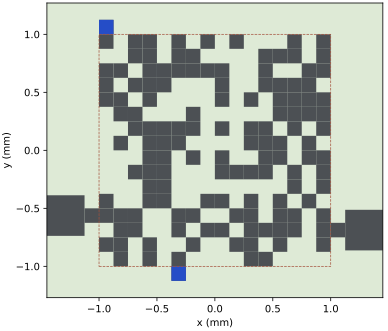
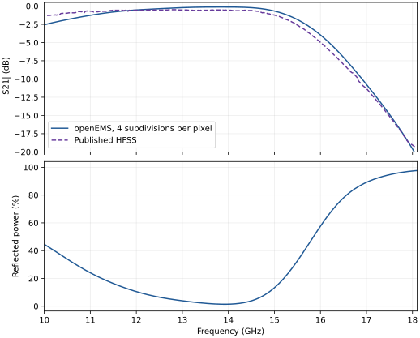

# Dall-EM 図3(a)の回路再現と応答の比較

図3(a)のローパス回路を、中央の16×16マスク、外周の短絡2か所、マスク手前で幅が変わる左右の給電線から組み立て、openEMSで解析した。1画素4分割のモデルでは、論文のHFSS曲線に対するS21のRMSEは10.5–18 GHzで **0.58 dB** だった。10.5 GHzのS21は **−1.85 dB** で、HFSS読取値より **0.88 dB低い**。形状を変えた比較では、低域の反射に対する寄与は短絡の配置が大きかった。[原論文](https://doi.org/10.1109/IMS40360.2025.11103838) · [比較データ](data/terminal-study-summary.csv)

## 1. 背景とモチベーション

### 1.1 マスクから周波数応答を計算する目的

原論文は、目標とする周波数応答から金属配置を生成する逆設計を扱う。構造を18×18の画素表現で学習し、10–30 GHzを1 GHz間隔で表した21点のS21振幅を拡散モデルの条件入力とする。学習用の構造と応答の組は電磁界解析で作成している。[原論文・II-B、III](https://doi.org/10.1109/IMS40360.2025.11103838)

本プロジェクトの目的は、二値マスクを一定の材料・給電・計測条件で解析するPythonライブラリを用意し、公開回路の応答を独立したソルバで検証することである。回路の見た目が同じでも、基板、給電線、短絡、ポートの条件が違えば応答は変わる。形状の整合、S行列の抽出、数値設定への依存、原論文との一致をそれぞれ確認する。

比較対象には、給電寸法とHFSSの応答曲線が公開された図3(a)を選んだ。主な比較対象は原論文の数値解析結果である。図4の試作測定と先行COMSOLの画像は、異なる構造・解析条件を含むため図3(a)の一致判定には用いない。

### 1.2 ターゲットと再現性の参照値

原論文の設計ターゲットには、理想フィルタの仕様を用いた例がある。図3(a)の要求は10–15 GHzの通過域と16–30 GHzの阻止域である。既存のマスク回路の応答だけをターゲットとしているわけではなく、この仕様を満たす配置の探索自体が逆設計の課題になる。[原論文・III-A、III-B](https://doi.org/10.1109/IMS40360.2025.11103838)

本プロジェクトでは、ターゲットへの近さと原論文の再現性を別に評価する。[ターゲット例](../examples/data/lowpass-target.csv)は、上記の帯域に線形振幅1・0を指定した理想ローパスの21点である。これは利用例として定めた配列で、著者の数値ターゲットを取得したものではない。再現性の参照値には、図3(a)の紫色のHFSS曲線を画像から読み取った振幅を使う。

### 1.3 実装する範囲と対象外

実装範囲は、内側16×16のマスク入力、3次元モデルの生成、openEMSによる両側励振、全複素Sの抽出・保存、Python APIとCLI、利用側のRMSE採点スクリプトである。基板・給電・短絡は設定から付加し、マスクと実効設定、終了判定、波形、応答を再確認できる形で保存する。

今回の範囲から外すものは次のとおりである。

- 拡散モデルやCNNの学習、マスク生成、最適化アルゴリズム。
- 基板製造と実測、実材料・製造品の性能保証。
- 18×18の端子込み表現の自動変換と、入力マスクの接続・隙間の自動修正。
- Web UIとHTTPサーバーの追加。
- 厳密な受動性について、数値的な電力超過をゼロまで追求する作業。残差は記載し、S行列を受動性へ強制補正しない。

未知の材料値や寸法を曲線へ合わせた条件は、原論文の条件として確定しない。感度試験の仮定値と、出典から確認できた条件を区別する。

## 2. 図3(a)のモデル

再現計算の入力は、中央の金属パターンを収録したCSVと、外周短絡・給電線・計算条件を指定するYAMLである。[マスクCSV](../examples/data/fig3a-mask.csv) · [再現用YAML](../examples/configs/paper_outer_terminals.yaml)

図3(a)には、10–15 GHzを通過域、16–30 GHzを阻止域とする回路が示されている。中央の金属パターンは2 mm角の16×16セルで、画像から読み取った金属セルは132個である。論文の学習入力は18×18で、図2の端子枠と照合すると、中央の16×16とその外周に置く端子情報に対応する。公開された先行COMSOL形状画像との照合でも、中央マスクの差は0/256セルだった。[抽出条件](data/paper-extraction.json) · [格子と端子枠の照合](data/grid-measurements.json) · [先行実装との照合](data/prior-art-verification.json)

| 項目 | モデルの設定 | 原図との対応 |
|---|---|---|
| 中央マスク | 16×16、ピッチ0.125 mm | 図3(a)から抽出 |
| 左右の給電線 | 各12 mm。幅0.35 mm、マスク直前の長さ0.125 mmは幅0.125 mm | 右の給電長と広い部分の幅は原図の注記。左の長さは同じと仮定し、絞り部は約1セル角とした |
| 給電線の中心 | 左 y = −0.5625 mm、右 y = −0.6875 mm | 原図から推定 |
| 外周の短絡 | 上面の外周セル2つに幅0.125 mmのPEC角柱を置き、裏面GNDまで接続 | 外周の位置は原図から読取。角柱の寸法と形状はモデルの仮定 |
| 基板・導体 | RO4350B相当、比誘電率は一定の3.66、厚さ0.16764 mm（6.6 mil）、基板の導電率0。上面PEC厚0.035 mm | 図2の基板と導体厚を採用。材料損失、銅の粗さ、分散はモデル化していない |
| ポート | 左右を独立に励振するMSLポート。実数50 Ω、測定面 x = ±10 mm、励振面 x = ±11 mm。測定面間に左右各9 mmの給電線を含む | HFSSのポート型、正規化、基準面、デエンベディングは論文から確定できない |
| 境界 | x = ±13 mmにPML8、y = ±3 mmとz = 3 mmにMUR、底面z = 0の全面をPECとして裏面GNDを表す | 原論文のGND範囲は不明 |

短絡位置は、行を上から下へ、列を左から右へ0始まりで数えると、（行, 列）= (−1, 0) と (16, 5) である。各位置に上面金属を1セルずつ加え、隣接する中央マスクの金属に接続する。

原図の給電線は、マスク直前が約1セル幅、その外側が約2.7〜2.8セル幅である。マスク内の角接触は画像どおりに保持した。短絡の径、ランド、めっきは図から確定できない。

解析に使った形状XMLから中央付近を描画した。破線は中央の2 mm角、青は裏面GNDにつながる短絡の平面投影である。

## 3. HFSS曲線に対する再現結果

外周短絡・細い給電接続の主結果には1画素4分割、基板厚方向8分割の格子を用いた。最大格子間隔は0.20 mm、広い給電線の縁付近の局所間隔は0.0125 mmである。2回の独立励振はともにエネルギー終了条件10⁻⁶を満たした。全複素Sは10–30 GHzの401点で取得した。[4分割の全複素S](data/fig3a-outer-terminals.s2p)

| 指標 | openEMS・4分割 | 原論文HFSS | 差 |
|---|---:|---:|---:|
| S21・10.5 GHz | −1.848 dB | −0.965 dB | −0.883 dB |
| S21・12 GHz | −0.531 dB | −0.567 dB | +0.036 dB |
| 下降側−3 dB交差 | 15.800 GHz | 15.600 GHz | +0.200 GHz |
| S21のdB RMSE・10.5–14 GHz | 0.46 dB | 比較の参照曲線 | 8点 |
| S21のdB RMSE・10.5–18 GHz | 0.58 dB | 比較の参照曲線 | 16点 |

上段はS21、下段はポート1からの入射に対する反射電力比。紫の破線が論文のHFSSである。RMSEは0.5 GHz刻みの各評価点を等重みで計算した。HFSS曲線の読取範囲は約10.06–18.08 GHz、画像読取誤差の目安は±0.15 dBと±0.06 GHzである。反射と位相の論文値は未取得のため、下段にはopenEMSの結果を表示する。[HFSSの読取値](data/paper-hfss.csv) · [抽出条件](data/paper-extraction.json)

下降側−3 dB交差は、S21が−3 dBを上から下へ横切る周波数を直線補間して求めた。表のRMSEはdB振幅の差を評価する。HFSS曲線は−20 dB付近で図から見切れるため、阻止域全体の一致はこの比較から判断できない。

## 4. 形状の寄与と材料の補足試験

### 4.1 外周短絡と給電の絞り

外周短絡と細い給電接続を備えた図3(a)の再現モデルを比較の基準とする。短絡を内側へ移すときは外側の2セルを外し、隣接する（行, 列）= (0, 0) と (15, 5) に短絡を置いた。給電を一定幅にするときは絞り部を0.35 mmに広げた。1画素2分割の4ケースで中央マスク、材料、励振位置、測定面、50 Ω正規化、境界、格子を共通にした。

| 再現モデルからの変更（2分割） | 反射電力比・10.5 GHz | S21・10.5 GHz | S21のdB RMSE・10.5–18 GHz |
|---|---:|---:|---:|
| 変更なし（外周短絡・細い給電接続） | 31.9% | −1.73 dB | 1.56 dB |
| 短絡だけ内側に移す | 60.1% | −4.03 dB | 2.40 dB |
| 給電だけ一定幅にする | 30.1% | −1.64 dB | 1.49 dB |
| 短絡を内側に移し、給電を一定幅にする | 58.2% | −3.89 dB | 2.33 dB |

短絡を内側に移すと、10.5 GHzの反射電力比は28.2ポイント増え、S21は2.30 dB低下した。給電だけを一定幅にすると、同じ周波数でS21は0.09 dB上がった。この比較では低域に対する短絡配置の寄与が大きい。短絡を内側に移した条件には外側の金属セルの除去も含まれるため、角柱の位置と金属セルの寄与は個別には求めていない。[比較データ](data/terminal-study-summary.csv)

外周短絡を固定し、マスク直前の幅0.125 mmと0.35 mmを同じ2分割格子で比較した。上段はHFSS曲線と両条件のS21、下段は一定幅から絞りありの値を引いた差である。10–15 GHzでは、一定幅のS21は10 GHzで0.11 dB上がり、15 GHzで0.18 dB下がった。[10–30 GHzの数値](data/terminal-feed-width-s21.csv)

左が再現モデル、右が短絡を内側に移し、給電を一定幅にした条件。4分割格子で両方を変えると、10.5 GHzの反射電力比は33.9%から58.4%、S21は−1.85 dBから−3.96 dBになり、HFSSに対するRMSEは0.58 dBから1.16 dBに増えた。

短絡を完全に除いた試験では最初の励振が減衰条件を満たさず、有効な全Sを得ていない。[短絡除去の終了状態](data/no-shorts-status.json)

内側短絡で給電の絞りだけを調べた別の粗格子試験では、絞りを入れると10.5 GHzのS21が0.152 dB低下し、下降側−3 dB交差は0.058 GHz上がった。給電端の幅を変えた結果であり、他の接続形状への一般化には追加検証を要する。[個別試験の数値](data/feed-comparison.json) · [固定した条件](data/feed-controlled-variables.json)

### 4.2 補足試験での基板の厚さ・誘電率・損失

材料の補足試験は、短絡を内側に移し、給電を一定幅にした形状で行った。マスク、給電寸法、短絡、PEC厚、50 Ω参照、測定面、境界を固定し、2分割格子で6条件、4分割格子で無損失RO相当を含む4条件を比較した。全20励振が正常終了し、減衰条件10⁻⁶を満たした。[設定と計画](data/material-experiment.json) · [材料・格子の監査](data/material-audit.json)

| 条件 | εr | 厚さ mm | 10 GHzのtanδ | 確認した画素分割 |
|---|---:|---:|---:|---|
| 無損失RO相当 | 3.66 | 0.16764 | 0 | 2・4 |
| 誘電率だけ変更 | 4.4 | 0.16764 | 0 | 2・4 |
| RO相当の誘電損失を追加 | 3.66 | 0.16764 | 0.0037 | 2 |
| εr=4.4とFR4相当の損失 | 4.4 | 0.16764 | 0.02 | 2・4 |
| 薄い基板 | 3.66 | 0.125 | 0 | 2・4 |
| 厚い基板 | 3.66 | 0.4 | 0 | 2 |

εr=4.4、tanδ=0.02、厚さ0.125/0.4 mmは感度試験の仮定値で、先行COMSOLの確認済み設定ではない。RO4350Bのtanδ=0.0037はRogers公式データシートの10 GHz値を参照する。試験ではκ=2πf₀ε₀εr tanδ(f₀)、f₀=10 GHzの一定導電率に換算するため、tanδ(f)=tanδ(10 GHz)×10 GHz/fとなる。10–30 GHzで一定tanδや実材料の分散を与えた試験ではない。

材料変更時に給電幅を50 Ωへ再設計していないため、線路インピーダンスと接続条件の変化も結果に含む。計測面間に含む左右各9 mmの給電線にも損失が加わる。厚さ変更では上側境界z=3 mmを固定するので、空気層の厚さも変わる。

同じ細分化方針の4分割で比較した4条件の原論文に対する誤差は次のとおりである。通過域は10.5–14 GHz、下降域は14.5–18 GHzの各8点で、全体は16点を等重みで評価する。厚さ変更ではz格子が異なる。

| 条件・4分割 | 通過域dB RMSE | 下降域dB RMSE | 全体dB RMSE | −3 dB交差の絶対誤差 GHz |
|---|---:|---:|---:|---:|
| 無損失RO相当 | 1.50 | 0.78 | 1.20 | 0.032 |
| 誘電率だけ4.4 | 0.56 | 15.90 | 11.25 | 1.065 |
| εr=4.4＋FR4相当損失 | 1.53 | 16.01 | 11.37 | 1.424 |
| 厚さ0.125 mm | 0.85 | 3.15 | 2.31 | 0.227 |

紫がHFSS、黒・青・橙・桃が4分割の各条件、灰色破線が内側短絡・一定幅給電の9分割。左は下降域を含むS21、右は同じS21の10–14 GHz拡大図である。[SVG](figures/material-paper-comparison.svg)

比誘電率を3.66から4.4へ上げると、−3 dB交差は2分割で1.103 GHz、4分割で1.097 GHz下がり、10.5 GHzのS21はそれぞれ2.038 dB、1.995 dB上がった。通過域の誤差は減り、下降域と遮断周波数の誤差は増えた。

損失を追加すると、10.5 GHzのS21はRO相当の2分割で約0.141 dB、εr=4.4の4分割で約0.987 dB低下した。基板を0.125 mmに薄くすると、4分割の10.5 GHzでS21が約1.200 dB上がり、下降域では誤差が増えた。厚さ0.4 mmの2分割では、全体のdB RMSEは厚さ0.16764 mmの2.60から2.55になった。この厚さの4分割以上は未検証である。[採点数値](data/material-paper-selection.json)

材料試験の2→4分割の最大複素S差は約0.199–0.243で、精度基準0.02を満たさない。無損失RO相当の4分割と9分割の差も最大複素S差0.113、−3 dB交差0.150 GHzである。4分割の交差が原論文へ近いことだけを、9分割より正確という根拠にはしない。材料差の傾向と、各条件の絶対値の収束は区別する。[細分化比較](data/material-refinement.json)

## 5. 抽出と数値検証

### 5.1 全S行列の抽出

抽出式は、2回の独立励振で得た両ポートの入射波を列に並べた行列Aと、出射波を列に並べた行列Bから、S=BA⁻¹として全成分を求める。非励振側の残留入射波もAへ含める。ポートは共通の実数50 Ωで定義し、給電端は導体内側1/3・外側2/3の格子配置を検査する。電流は対称な2点で計測し、導体厚を含む計測範囲を確保する。

既知S行列と相互入射を含む模擬波形を本番の後処理に与えた最大復元誤差は1.11×10⁻¹⁶だった。内側短絡・一定幅給電の9分割データの入射行列の最大条件数は1.0236である。材料試験10ケースでは、保存波形からの再抽出と保存Sの最大複素差は全ケースで0だった。これらは抽出と保存の一貫性を確かめる検査であり、ポート場の物理的な正確さを別ソルバで確認した結果ではない。[抽出式の検査](data/prior-art-verification.json)、[再抽出](data/material-extraction-verification.json)

ライブラリの検査は、入力拒否、Sの成分順序、新規解析時の入出力、保存済み応答の読み込み、採点式、CLIの出力を対象とする。保守する[抽出の回帰テスト](../tests/test_postprocess.py)は、周波数ごとに各成分が異なる既知の全Sと相互入射を本番後処理へ与え、抽出結果とCSV・Touchstoneの成分順序を検査する。[実行・比較の回帰テスト](../tests/test_execution.py)は、未完了・未減衰の解析を正常結果や格子差の合格として扱わないことを確認する。

### 5.2 格子差と電力

数値検証では物理条件を固定し、格子細分化による全複素S、10–14 GHzのS21、下降側−3 dB交差の変化を調べる。判定基準はプロジェクトで定めた数値差の目安であり、原論文から引用した再現性の合格条件ではない。

| 検査 | 判定基準 | 内側短絡・一定幅給電の結果 |
|---|---|---|
| 解析の完了 | 両励振の正常終了と設定した減衰条件の達成 | 両励振で10⁻⁷を達成 |
| 全Sの格子差 | 10–30 GHzの401点・全4成分で最大複素絶対差≤0.02 | 8→9分割で0.011985 |
| 帯域振幅の格子差 | 10–14 GHzのS21最大差≤0.2 dB | 0.02584 dB |
| 特徴周波数の格子差 | 細分後の−3 dB交差を分母として変化≤1% | 0.1012% |
| 電力の数値許容 | 最大σmax(S)²≤1.02 | 1.00454。厳密な受動性は未達 |

複素絶対差0.02は0.02 dBや相対誤差2%ではない。実数50 Ωの波で定義した最大特異値σmax(S)の二乗は、任意の入射波の組合せに対する最大電力比を表す。厳密な受動性には1以下を要求する。

| 同形状の格子比較 | 最大複素S差 | 10–14 GHzのS21最大差 | −3 dB交差の変化 |
|---|---:|---:|---:|
| 画素4→6分割 | 0.077155 | 0.06031 dB | 0.6346% |
| 画素6→8分割 | 0.025706 | 0.02207 dB | 0.1997% |
| 画素8→9分割 | 0.011985 | 0.02584 dB | 0.1012% |

画素とともに基板・最大間隔・給電端近傍も細分化しており、格子はすべて入れ子ではない。同梱の標準設定には、最後の比較で基準を満たした9分割を用いる。直線線路の基準モデルでは最後の最大複素S差0.004473を確認した。同梱設定の9分割での最大相反性誤差|S12−S21|は0.0007445である。格子差・終了判定・相反性の確認だけでは、境界独立性や厳密な受動性の検証は完了しない。[格子比較](data/mesh-comparison.json)、[監査](data/convergence-audit.json)

外周短絡・細い給電接続の4分割でも両励振が減衰条件を満たし、最大σmax(S)²は1.00481だった。追加した4分割の結果は数値許容1.02以内に収まる。外周短絡・細い給電接続の9分割での全S比較、ビア実寸、有限なランドや微小隙間、境界距離と吸収条件の影響、同一形状でのHFSS全複素Sとの照合は未確認である。

同梱設定の9分割は、基板厚方向16分割、最大間隔0.075 mm、給電端の局所間隔約0.004167 mmである。電流は測定面から前後0.025 mmで計測する。最大400,000ステップ、各励振のタイムアウト7,200秒とし、約549万の幾何セルを4スレッドで計算した記録では2励振に約58分を要した。大量のマスクを評価する費用は未評価である。

### 5.3 残る検証

| 対象 | 未実施の比較 |
|---|---|
| 格子と境界 | 再現モデルの細分化を進め、内部格子と測定面を固定してy方向と上側の境界距離を個別に3 mmから6 mmへ広げる。距離を固定したMURとPMLの比較も行う |
| 端子と画素の接続 | 外周金属セルと短絡位置の寄与、ビア寸法、微小隙間、角接触、給電接続の寸法を調べる |
| 別ソルバ | 形状・材料・ポート・基準面をそろえて全複素Sを比べる。原論文のCAD、数値マスク・応答、解析設定があれば仮定の差を確認できる |
| 代表マスク群 | 空、全面金属、直線接続、非対称、孤立島、角接触を含むマスクで格子差と受動性を調べ、教師データとして使える精度を検証する |

## 6. ライブラリで再現できる範囲

公開APIとCLIは、16×16のマスクからモデルを組み立て、両励振の結果から全複素Sを求め、入力・設定・応答を保存する。外周短絡と細い給電接続を含む第3節の回路は、再現用の設定例を `inspect` や `evaluate` の `--config` に渡して指定できる。[利用方法](usage.md#短絡と給電線の設定) · [再現用の設定例](../examples/configs/paper_outer_terminals.yaml)

同梱の標準YAMLと完了済み応答のfixtureは内側短絡・一定幅給電の9分割モデルに対応する。このモデルの短絡中心は（x, y）= (−0.9375, +0.9375) と (−0.3125, −0.9375) mmである。[標準YAML](../src/maskrf/configs/paper_corrected.yaml) · [編集用設定例](../examples/configs/paper_corrected.yaml) · [保存済み応答](../tests/fixtures/README.md)

同梱設定を `maskrf inspect` で描くと、平面図と基板・裏面GNDの概略断面図を確認できる。赤線はSパラメータの測定面、青い四角は短絡角柱の平面投影である。[同梱設定の形状図](figures/fig3a-package-example.svg)

APIは二値配列・CSV・JSON・白黒PNGを受け付け、全Sの複素値・振幅・位相、指標、実効設定を返す。新規解析では両励振の正常終了と減衰を確認し、完了済みの応答は `load_response()` で読み込める。個別の格子収束や受動性による自動選別は未実装である。wheelを独立環境に入れ、ソースディレクトリ外から利用できることも確認した。内側短絡・一定幅給電の9分割データを生成したコア実装は、保存時の記録で `model.py`、`geometry.py`、`postprocess.py` の一致を確認している。[コア実装の照合](data/report-metrics.json)

### 6.1 目標応答への採点

ターゲットとの近さは、目標周波数に補間した線形振幅 |S21| のRMSEで評価する。RMSEは論文の平均L1より大きな誤差の寄与を強める。評価点は等重みで、位相は採点に含めない。10–15 GHzの6点を1、16–30 GHzの15点を0とした理想ローパスの例では、内側短絡・一定幅給電の9分割モデルのRMSEは0.20037665494010062である。この例では阻止域の点数が多く、帯域ごとの合否と理想目標の実現可能性は未検証である。目標を満たすマスクの逆設計と、生成マスクの論文マスクとの比較は本レポートの評価範囲外である。[ターゲット例](../examples/data/lowpass-target.csv) · [採点の検証](data/target-score-verification.json)

### 6.2 同梱設定のHFSS比較と電力収支

内側短絡・一定幅給電の9分割データを論文のHFSS曲線と比べると、次の差がある。第3節の再現結果とは、端子形状と格子の両方が異なる。

| 指標 | 同梱設定・9分割 | 原論文HFSS | 差 |
|---|---:|---:|---:|
| S21・10.5 GHz | −3.924 dB | −0.965 dB | −2.959 dB |
| S21・12 GHz | −1.681 dB | −0.567 dB | −1.114 dB |
| S21・14 GHz | −0.541 dB | −0.567 dB | +0.027 dB |
| S21・16 GHz | −3.984 dB | −4.982 dB | +0.998 dB |
| 下降側−3 dB交差 | 15.782 GHz | 15.600 GHz | +0.182 GHz（約1.17%） |

HFSSに対するS21のdB RMSEは、10.5–18 GHzで1.20 dB、10.5–14 GHzで1.54 dB、14.5–18 GHzで0.70 dBである。10.5 GHzの差は画像読取誤差と同じ形状での最後の格子差を上回る。[応答の比較図](figures/adopted-ro-paper.svg) · [比較指標](data/report-metrics.json)

ポート1励振時の反射を |S11|²、透過を |S21|²、両ポートで回収しない割合を 1−|S11|²−|S21|² として求めた。回収しない割合には放射、境界への流出、数値誤差が含まれる。

| 周波数 | 反射電力 | 透過電力 | 両ポートで回収しない電力 |
|---|---:|---:|---:|
| 10.5 GHz | 59.01% | 40.51% | 0.48% |
| 12 GHz | 31.29% | 67.90% | 0.80% |

この形状で低域の透過を制限している主な成分は反射である。基板の吸収損失をゼロとしているため、回収しない電力も放射や境界への流出などに由来する。[電力収支](data/report-metrics.json)

### 6.3 先行COMSOLとの比較

Obsidian-Journalsの先行COMSOL画像から、S11とS21の振幅を10–30 GHzで0.5 GHz間隔の41点読み取った。読取誤差の目安は±0.2 dBと±0.07 GHzである。先行COMSOLのS21は10.5 GHzで約−1.29 dB、下降側−3 dB交差は約13.96 GHz、30 GHzで約−3.12 dBだった。同梱設定の30 GHzのS21は−25.65 dBで、論文HFSSの30 GHzは図から読み取れないため、比較値はない。[先行COMSOLの読取値](data/comsol-metrics.json)

再現記録にはFR4を仮定したとの説明がある。誘電率・基板厚・給電・短絡・ポートの詳細と全複素Sがそろっていないため、数値差の原因は特定できない。記事とObsidianの画像は同じ作業者の結果である。PlayGroundは中央の金属形状の照合に使い、gerber-gen-testはopenEMSの形状生成例として参照した。後者の片側励振で得た出射波／入射波をS22として用いる手法では、全S行列の正解データを得られない。[先行資料](#72-先行実装と再現記録)

## 7. 参考資料

### 7.1 一次資料

1. Yingqing Guo et al., *Dall-EM: Generative AI with Diffusion Models for New Design Space Discovery and Target-to-Electromagnetic Structure Synthesis*, IMS 2025. [DOI](https://doi.org/10.1109/IMS40360.2025.11103838)。図2の構造条件、図3(a)のマスク・HFSS振幅、II-B・IIIの学習入力と設計ターゲットを参照。
2. [openEMS公式メッシュ指針](https://wiki.openems.de/index.php/FDTD_Mesh.html)、[固定版MSL Notch Filter例](https://github.com/thliebig/openEMS/blob/5f36e7f3a2367123f00999491a069aed50c6f244/python/Tutorials/MSL_NotchFilter.py)。給電端の格子とポート計測の根拠。
3. [Rogers RO4000公式データシート](https://rogerscorp.com/-/media/project/rogerscorp/documents/advanced-electronics-solutions/english/data-sheets/ro4000-laminates-ro4003c-and-ro4350b---data-sheet.pdf)。設計用εr=3.66と10 GHzのtanδ=0.0037を参照。
4. Chai & Draxler (2014), [RMSE or MAE?](https://gmd.copernicus.org/articles/7/1247/2014/)。評価量の定義と大きな誤差の寄与に関する資料。

### 7.2 先行実装と再現記録

1. [PlayGroundの形状生成コード](https://github.com/jwt625/PlayGround/blob/4e2c82c32cdd28d50bf28b2da663e0c1af45650e/20250624_inv_design_filter/main.py)。固定コミットの16×16形状生成を参照。
2. [Obsidian-JournalsのCOMSOL作業記録](https://github.com/jwt625/Obsidian-Journals/blob/67227f7579e27259e75e9fadcefe345f856e5137/Playground/20250624%20inverse%20designed%20microwave%20filters.md)、[S11・S21の10–30 GHz画像](https://github.com/jwt625/Obsidian-Journals/blob/67227f7579e27259e75e9fadcefe345f856e5137/10-30GHz.png)。固定コミットのマスク・振幅画像を照合。
3. [gerber-gen-testの解析コード](https://github.com/VatsalKhanna5/gerber-gen-test/blob/4a722231e15d9d6c0c55b29070a42d61186db99b/rfgerber/em_simulation.py)。形状生成とS22抽出方法を確認。
4. [Vik's Newsletterの再現記録記事](https://www.viksnewsletter.com/p/dallem-in-30-hours)。FR4の仮定に関する二次資料。記事中の別のMegtron 6試作測定は今回の比較対象に含めない。

### 7.3 保存データ

| 内容 | 保存先 |
|---|---|
| 端子形状6ケースの比較 | [集計CSV](data/terminal-study-summary.csv) |
| 外周短絡・細い給電接続の4分割応答 | [全複素SのTouchstone](data/fig3a-outer-terminals.s2p) |
| 内側短絡・一定幅給電の9分割応答 | [全複素SのCSV](../tests/fixtures/completed-run/sparameters.csv)、[実効設定](../tests/fixtures/completed-run/effective.json)、[終了判定](../tests/fixtures/completed-run/status.json) |
| 内側短絡・一定幅給電の図の入力と生成手順 | [Touchstone](data/adopted-network.s2p)、[比較指標](data/report-metrics.json)、[描画コード](../examples/plot_report.py) |
| 材料の補足試験 | [全ケース一覧](data/material-summary.csv)、[HFSSとの比較指標](data/material-paper-selection.json) |
| 条件の出典と従来モデルの記録 | [条件・仮定](data/conditions.md)、[保存データの一覧](data/README.md) |

ライブラリと回帰テストは、リポジトリに同梱したデータで利用・検査できる。新しい実行の波形・ログ・作業記録は作業用の `tmp/` に保存する。
